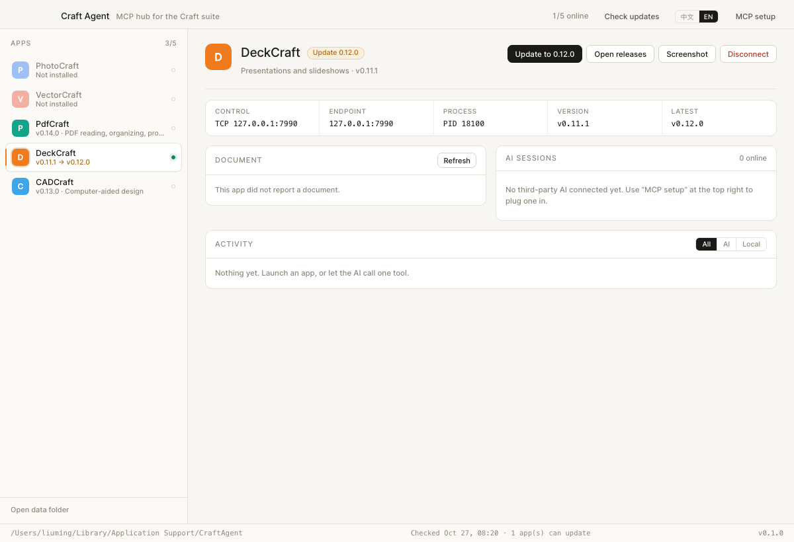

# Craft Agent

**An MCP hub for the Craft App Suite** — one binary that puts DeckCraft, WordCraft,
GridCraft, PhotoCraft and the rest of the suite behind a single MCP server, and shows you
what an agent is doing to them while it does it.

<p align="center">
  
  
  
  
  
</p>

<p align="center">
  <a href="README.zh-CN.md">中文</a> ·
  <a href="#what-it-is">What it is</a> ·
  <a href="#install">Install</a> ·
  <a href="#build-from-source">Build</a> ·
  <a href="#mcp-tools">MCP tools</a> ·
  <a href="docs/control-protocol.md">Protocol</a>
</p>

<p align="center">
  
</p>

## What it is

The Craft apps are desktop graphics tools. Each one can open a local control endpoint
(`--control`) and be driven over a line-oriented JSON protocol — that is the seam this
project builds on.

One binary, two ways to run it:

- **`craft-agent`** opens a window: which apps are installed, which are running, on what
  endpoint, what document each one has open, and a live log of every command that went
  through — with AI-issued commands distinguishable from your own clicks.
- **`craft-agent mcp`** is an MCP server on stdio, for Cursor, Claude Desktop, or anything
  else that speaks MCP. It talks to the same app processes the window does.

There is deliberately no editor and no built-in chat. The AI comes in through MCP, you come
in through the app's own window, both touch the same process and the same file, and every
action lands in the same log.

## Why not just another launcher

[ArtCraft Launcher](https://github.com/storytold/craft-launcher) solves install-and-open.
This project solves **letting an agent act, with a human able to see it**:

| | Launcher | Craft Agent |
|---|---|---|
| First install | ✅ | ✅ same path as an upgrade: checksum → signature → put in place |
| Upgrade | ✅ | ✅ download → checksum → verify signature → swap → keep backup |
| Uninstall | ✅ | ❌ drag the app to the Trash |
| App state | a list | list + control endpoint + process + open document |
| Agent access | ❌ | ✅ one MCP server for the whole suite |
| Audit trail | ❌ | ✅ cross-process log, AI actions separated from local ones |

## The protocol, briefly

Full write-up with measured behaviour: [`docs/control-protocol.md`](docs/control-protocol.md).

```
→ {"id":1,"method":"engine.execute","params":{"command":"slide.new","params":{"layout":"titleOnly"}}}
← {"id":1,"ok":true,"result":{"id":257,"index":0}}
```

Four facts shape the whole design:

1. **JSON Lines, one request per line.** The `action={"key":"value"}` shape you'll find
   online is wrong; the server answers `not a control request (missing string 'method')`.
2. **The transport differs per app.** DeckCraft 0.11.1 takes a TCP port, PdfCraft takes a
   Unix socket path. Transport is a per-app attribute, not a global constant.
3. **The command table is discoverable.** `engine.commands` returns 377 entries on
   DeckCraft 0.11.1, each with label, menu path and prose parameter docs. MCP tools are
   generated from it, so no command name is hard-coded.
4. **Documents exist but are not published.** `file.new` returns a document number, yet
   there is no document id, no list, and no command that takes one — the only way to switch
   is `window.next {index}`, which is the missing `document.activate` under another name.

## Architecture

```
┌───────────────────────────┐        ┌──────────────────────────────┐
│ Cursor / Claude Desktop   │        │ You (looking at the window)  │
└─────────────┬─────────────┘        └──────────────┬───────────────┘
              │ MCP (stdio, JSON-RPC)                │ clicks
              ▼                                      ▼
┌──────────────────────────────┐        ┌──────────────────────────────┐
│ craft-agent mcp              │        │ craft-agent (GUI)            │
│  · craft_* tool layer        │        │  · apps / status / log        │
│  · command-table discovery   │        │  · launch · connect · detach  │
└─────────────┬────────────────┘        └──────────────┬───────────────┘
              │  control channel (JSON Lines over TCP / Unix socket)
              └───────────────────┬────────────────────┘
                                  ▼
                    ┌──────────────────────────────┐
                    │ DeckCraft / WordCraft / …     │
                    │ --control <endpoint>          │
                    └──────────────────────────────┘

        ┌─────────────────────────────────────────────┐
        │ registry.json   which app is on which endpoint │
        │ sessions.jsonl  every command, cross-process    │
        └─────────────────────────────────────────────┘
```

The GUI and the MCP process share no memory. They agree through two files in the data
directory:

- **`registry.json`** — the GUI writes endpoint and PID when it launches an app; the MCP
  process reads it to attach to *the same* instance, and falls back to probing the default
  endpoint if the file has nothing.
- **`sessions.jsonl`** — who connected, what was called, whether it worked, how long it
  took. The window polls it every two seconds.

## Layout

```
main.go                     one entry point: GUI / mcp / apps / versions / update / run
internal/
  craft/catalog.go          the suite: install path, launch flags, transport
  control/client.go         channel client (TCP / Unix, request-response, reconnect)
  control/api.go            semantic methods: Commands / Execute / Document / Screenshot
  host/host.go              process host: discover, launch, assign endpoints, registry
  journal/journal.go        cross-process activity log (JSONL, rotates)
  mcp/server.go             MCP server: meta tools + command-table discovery
  mcp/compose.go            deckcraft_text / deckcraft_style / deckcraft_page / craft_batch
  mcp/doc.go                craft_doc: document anchor and pre-write guard
  release/feed.go           latest versions: official feed first, GitHub fallback, 6h cache
  release/installed.go      local versions from Info.plist / file version / --version
  update/update.go          pick asset, download, checksum
  update/install_darwin.go  macOS: mount dmg → verify signature → stage → swap → backup
services/app.go             Wails bindings (state, actions, log, updates, MCP config)
frontend/                   Vite + TypeScript, no framework; i18n in src/i18n.ts
docs/control-protocol.md    what we measured about the control channel
```

## Install

There are no prebuilt downloads for Craft Agent itself yet: this is 0.1.0 and the interface
still moves. Build it from source (next section) and put the binary anywhere on your `PATH`.

**The apps are a different matter — Craft Agent installs those.** Paste the binary on a fresh
machine, pick an app, press *Install*; or from a shell:

```bash
craft-agent install deckcraft        # first install, or upgrade if already there
```

It is the same code path as an upgrade, because on disk it is the same job: download, verify
the checksum, mount the image, verify the signature, put the bundle where it belongs. The only
differences are the destination (`/Applications`, or `~/Applications` when `/Applications` is
not writable) and whether an existing copy is moved aside as a backup.

Uninstalling is still yours: drag the app to the Trash. Craft Agent will notice it is gone.

## Build from source

Requires Go 1.25+, Node 18+, and the `wails3` CLI (v3.0.0-beta.29).

```bash
git clone https://github.com/extrame/craft-agent.git
cd craft-agent

# 1. front-end bindings (rerun after changing a bound method's signature)
wails3 generate bindings -ts -i

# 2. front-end bundle (embedded into the binary)
cd frontend && npm install && npm run build && cd ..

# 3. build
go build -o bin/craft-agent .
# or a full packaged app:
wails3 build
```

> The binary embeds `frontend/dist`. You can build without step 2 — the window then
> shows a "front end not built" page instead, while `craft-agent apps` and
> `craft-agent mcp` keep working from the command line.

Development: `wails3 dev` (hot reload for the front end, restart on Go changes).

To check the interface without a backend:

```bash
python3 tools/preview_mock.py 8799   # serves frontend/dist, answers Wails bindings with fixtures
```

It fakes the `/wails/runtime` binding calls so layout and both languages can be reviewed in
a browser. It is not part of the build and never enters the binary.

## Run

```bash
craft-agent                        # the status window
craft-agent apps                   # suite + local state (run this first when "it won't connect")
craft-agent versions               # local version vs latest release
craft-agent install deckcraft      # install, or upgrade if already installed (--dry-run: pick the asset only)
craft-agent update deckcraft       # upgrade only; refuses an app that is not installed
craft-agent run deckcraft slide.inspect
craft-agent run deckcraft file.new '{"blank":true}'
craft-agent mcp                    # MCP over stdio
craft-agent mcp --apps deckcraft,wordcraft --tools minimal
```

Data directory — macOS `~/Library/Application Support/CraftAgent/`,
Windows `%APPDATA%\CraftAgent\`, Linux `~/.local/share/craft-agent/`:

```
registry.json     endpoints and PIDs of running apps
sessions.jsonl    activity log
shots/            screenshots taken through craft_screenshot
run/              Unix sockets for apps that use them
releases.json     cached release info
cache/updates/    downloaded installers and staged bundles
```

The interface follows the system language and can be switched in the top-right corner;
the choice is stored in `localStorage`. Strings live in `frontend/src/i18n.ts` — no
dependency, `data-i18n` attributes plus `t(key, vars)` interpolation.

Closing the window only tucks it away: into the menu bar on macOS, into the notification area
on Windows. The process and the running apps are untouched. Click the icon to bring the window
back; the menu also carries "Open data folder" and "Quit". To actually quit, use that item or
`Cmd+Q`.

## MCP tools

The window's "MCP setup" button prints a snippet you can paste as-is:

```json
{
  "mcpServers": {
    "craft-agent": {
      "command": "/path/to/craft-agent",
      "args": ["mcp"]
    }
  }
}
```

Twelve tools. Three layers of context need three different treatments:

```
document   implicit, no parameters — can only be switched with window.next
  └ slide  implicit, insert.* takes no page — has to be pinned with slide.go
      └ shape  explicit, commands take ids — reliable
```

**Document layer** — the outermost layer, and the easiest one to overlook:

| Tool | What it does |
|---|---|
| `craft_doc` | `info` (identity of the active document), `list` (enumerate open documents), `use` (switch and anchor), `new`, `close`, `anchor` (re-anchor in place), `release` |

**Intent layer** — one call per intent, result verified by the app itself:

| Tool | Applies to | What it does | Raw sequence it replaces |
|---|---|---|---|
| `deckcraft_page` | DeckCraft | add / go to / delete / duplicate / move a page, ending on a known page | `slide.new` plus remembering to `slide.go` |
| `deckcraft_text` | DeckCraft | create or rewrite a text box with typography (font, size, bold, colour, alignment, anchor, bullets) and report what the app actually applied | `insert.textBox → edit.select → text.edit → text.selectAll → format.fontDialog → format.align → text.exit` |
| `deckcraft_style` | DeckCraft | restyle shapes by id, across pages, reporting per-shape success or failure | the same six commands, per shape |
| `craft_batch` | any app | many commands in one round trip, stopping on error, with an optional page pin | one round trip per command |

`craft_doc` and `craft_batch` are generic — they assume nothing about slides. The `deckcraft_`
prefix is the other half of that promise: those three tools refuse to run on any other app,
rather than fail halfway through a model that does not exist there.

**Raw channel** — the escape hatch:

| Tool | What it does |
|---|---|
| `craft_apps` | list the suite with install / online / endpoint state |
| `craft_open` | attach to an app, launching it if needed |
| `craft_inspect` | read the active document: pages, shape ids, selection |
| `craft_run` | execute one command (parameters documented per command); pre-write guard applies |
| `craft_commands` | search that app's command table |
| `craft_screenshot` | capture the window to a file, return the path |
| `craft_close` | detach, and stop what this session started |

## Why the `deckcraft_*` commands exist

The control channel is complete: it can do everything the app can do. It is not complete in
the sense a model needs, because **it has primitives, not intents.**

"Put this title on slide 3, 40pt bold, centred" has no command behind it. There are seven:
`insert.textBox`, `edit.select`, `text.edit`, `text.selectAll`, `format.fontDialog`,
`format.align`, `text.exit` — and each one only means anything if the previous one left the
right invisible state behind: a text selection, inside the right shape, on the right page, in
the right document. None of that state is visible to the caller, and none of it survives a
round trip.

So the missing layer is not more commands. It is **bookkeeping** — and bookkeeping is exactly
what a model cannot do reliably when its only feedback is a tool result, because every one of
those failures is silent:

| the state that has to be tracked | what happens when it is forgotten |
|---|---|
| which page is active | the insert lands on another page; the call still reports success |
| whether the id is on this page | `edit.select` returns `{"selected":[]}`; not an error |
| whether a text selection exists | `format.*` returns `null` or `select text or a shape` |
| which document is active | the whole write lands in a different file; no error anywhere |

A silent failure cannot be debugged by whoever sees only the tool output. It has to be
prevented by something that can read the state back — and that something has to be code.

The measurements behind each row, all on DeckCraft 0.11.1:

1. **`format.*` has no `ids` parameter.** It formats the current text selection, which does
   not survive across calls. Setting one text box's font is a fixed six-command dance, and a
   step failing just returns `null` or `select text or a shape`.
   → `deckcraft_text` and `deckcraft_style` fold it in and read back `format.state`, so the
   reported values are the app's own.

2. **A cross-page `edit.select` does not error; it returns `{"selected":[]}`.** Shape ids are
   only valid on their own page, and the channel never says so.
   → The tool finds the shape's page with `slide.inspect`, switches there, then checks whether
   it is actually in `selected`. If not, it stops and says why.

3. **`enabled` is runtime context, not availability.** With no text selection, `format.*` and
   `text.selectAll` report `enabled: false`. An earlier version filtered by `enabled` and the
   model could never find formatting commands at all.
   → Existence is decided by `id`; `enabled` is only a hint.

4. **The document layer has no parameters.** After you manually create or switch a document,
   an agent's next `insert` writes into *a different document*, silently.
   → Every write anchors on the active document (a `title + path` fingerprint from `file.info`)
   and compares before writing; on drift it **refuses to send the command** and explains how to
   switch back. Document-level commands (`file.new`, `window.next`, `file.close`) count as
   explicit intent and re-anchor afterwards.

5. **`insert.*` takes no page argument.** `slide.new` switches the page as a side effect, but
   `design.background {index}` switches it back, so following inserts land elsewhere.
   → `deckcraft_page` pins the page after creating it, `deckcraft_text` reports
   `verified.onSlide`, and `craft_batch` accepts a page to pin first.

For scale: "one title plus two paragraphs, then restyle both" is about twenty raw commands, at
least four of which fail on selection state and get retried. Through these tools it is one
`deckcraft_text` and one `deckcraft_style`, and a failure names the id it failed on.

### Why the prefix is `deckcraft_`

Because the model they assume is DeckCraft's: slides, text boxes, `format.*` acting on a
selection. WordCraft or GridCraft may not have `text.selectAll` at all, and PdfCraft's page is
a document page, not a slide. Calling them `craft_text` would promise a portability that was
never measured; `deckcraft_text` puts the scope in the name, and the tool enforces it — on any
other app it refuses and points at `craft_run`.

`craft_doc` and `craft_batch` keep the generic prefix because they genuinely are generic: they
move commands around and guard document identity without assuming what those commands mean.

### What they deliberately do not do

- **No rich-text runs.** One format per call. Bolding a single word inside a paragraph still
  needs `text.find` + `text.select` + `format.*` by hand.
- **No transaction.** A `craft_batch` that fails at step 7 leaves steps 1–6 applied. There is
  no snapshot to roll back to yet.
- **No layout engine.** They set the properties you name; they do not decide that a title
  should be 40pt.

One convention still holds: **one command is one undo step**. `craft_batch` removes round
trips, not undo granularity; Cmd+Z still undoes one command.

## Updates

Two packages, because the timescales differ:

- `internal/release` answers "what is the latest version". It runs at startup, hits the
  official aggregated feed (all thirteen apps in one request), falls back to GitHub, and
  caches for six hours. GitHub's anonymous limit is 60 requests per hour; a dozen apps at
  once would eat it on every launch — that is the only reason the feed comes first.
- `internal/update` answers "how does it get onto disk". It runs once when you press
  install or update, downloads a hundred-odd megabytes, mounts a disk image, and puts the app
  bundle in place — creating it on a first install, replacing it afterwards.

The order is fixed, and any failure stops where it happened:

| Step | What happens | On failure |
|---|---|---|
| Pick asset | exact `app-version-platform-arch.ext`, then suffix match; excludes `-cli-`, `-web-`, `SHA256SUMS`, `.zsync` | "no installer for this platform" |
| Download | streamed to `.part`; a dropped connection resumes with `Range`, backing off 1s→30s; hashed when complete | gives up only after eight attempts in a row make no progress (the `.part` stays); a checksum mismatch alone triggers a fresh start |
| Checksum source | the asset's `digest`, else `SHA256SUMS.txt` from the same release; neither → **refuse to install** | says the checksum is missing, does not proceed |
| URL allowlist | must be `https://github.com/<that app's repo>/releases/download/…`, redirects only to GitHub hosts | suspicious entries are dropped from the candidates |
| Mount | `hdiutil attach -nobrowse -readonly -noverify` into a scratch directory | retries four times; diskimages-helper accepts one image at a time |
| Verify signature | `codesign --verify --deep --strict`, and the signing team must match the **installed copy** | refuses to replace |
| Verify version | read the new bundle's `Info.plist` and compare with the release (first three components; bundles often carry numbers only) | refuses to replace |
| Swap | `ditto` next to the target → rename the old copy to `<App>.app.old-<time>` → rename the new one into place | a failed rename moves the old copy back |

- **Silent install only happens on macOS.** On Windows and Linux it stops at "downloaded and
  verified" and hands the installer to the system: msi needs elevation, deb/rpm/AppImage each
  install differently, and an unverified auto-install is worse than two clicks.
- A running app is asked to quit first (AppleScript `quit`, so you get a chance to save).
  If it will not quit, that is reported instead of force-killing it. If it was running
  before the update, it is started again afterwards.
- Progress comes from the `craft:update` event: downloads report a percentage and
  bytes transferred; verification and swapping show an indeterminate animation, because a
  stage of unknown length should not pretend to have a percentage.
- Repository renames are followed from the feed's `repo_renames` (same owner only): GitHub
  redirects a renamed repo, but **the redirected download URL belongs to the new repo**, so
  validating against the old name would reject every asset.
- Outbound traffic picks a proxy in this order: environment variables, then the system
  setting (macOS `scutil --proxy`, Windows Internet Settings in the registry), then direct.
  A GUI app launched from Finder or the Start menu does not inherit the shell's
  environment, so `HTTPS_PROXY` alone is worth nothing there — the user runs a system
  proxy, we connect directly to GitHub, and that is why large downloads crawl and break.
- Three clocks guard a download: 20s to connect, 60s to response headers, 5 minutes per
  attempt, plus a 45s stall detector on the body. All of them cut the attempt and resume
  rather than leaving the window saying "downloading" while nothing moves.

## Known limits

- **Only DeckCraft and PdfCraft have a measured transport.** The other eleven apps have a
  `--control` flag in `catalog.go` but no confirmed transport; the host tries a socket and
  reports "unconfirmed" rather than pretending.
- CADCraft 0.11 exposes no control flag on this machine — `--help` just opens the window.
- No built-in agent chat, by design: the point is to give third-party AI a capability and
  give a human a clear view.
- Twelve MCP tools today. Per-command tool generation (`--tools core|full`) stays reserved:
  a few hundred commands per app would fill a model's context.
- The `deckcraft_*` tools assume DeckCraft's model (`insert.textBox`, `text.selectAll`,
  `format.fontDialog`). They check the command table first and refuse, pointing at
  `craft_run`, if one is missing — and they refuse on any other app outright.
- No pre-write snapshot: a `craft_batch` that fails midway keeps the steps already applied.
  Rolling back is your undo, or a future `document.inspect` snapshot plus rebuild.
- **Document identity is `title + path`**, because the protocol has no document id. Two
  consequences: save-as or rename looks like a new document (use `craft_doc anchor`), and
  two windows on the same file cannot be told apart.
- `craft_doc list` really does switch through every window and back, so the screen flickers
  and it should not be polled while someone is working.
- The anchor is a single target per session: to touch two documents you must alternate with
  `craft_doc use`. That is a limit of the channel, not of the wrapper.
- A first install has no previous copy to compare against, so only the strict signature
  check runs; the "same signing team as the installed version" requirement can only apply
  to an upgrade.
- Backups (`<App>.app.old-<time>`) are never cleaned up automatically.
- No batch updates: one app at a time, and a failure affects only that app.
- Prereleases are not offered. If the feed marks a release `prerelease`, its version is
  shown but never suggested as an upgrade.
- `app_renames` is not followed: the install path is `<Name>.app`, so following a rename
  would mean no longer finding the installed copy.

## Contributing

Issues and pull requests are welcome, especially measured protocol facts. The one rule that
matters: **if you report behaviour, say which app and version you measured it on.** Every
table in `docs/control-protocol.md` is grounded that way, and a claim without a version is
a guess that will mislead the next reader.

Before sending a change:

```bash
go vet ./... && go test ./internal/...
cd frontend && npx tsc --noEmit && npx vite build --mode production
```

Live network tests are opt-in: `CRAFT_RELEASE_LIVE=1 go test ./internal/release/` and
`CRAFT_UPDATE_LIVE=1 go test ./internal/update/`. The latter downloads a real installer and
installs it into a scratch directory.

## License

MIT OR Apache-2.0, at your option — the same terms as the Craft App Suite itself. See
[`LICENSE-MIT`](LICENSE-MIT), [`LICENSE-APACHE`](LICENSE-APACHE) and [`NOTICE`](NOTICE).

This is an independent, unofficial project. It is not affiliated with the Craft App Suite
or its team; no app icon or brand asset is redistributed here.
