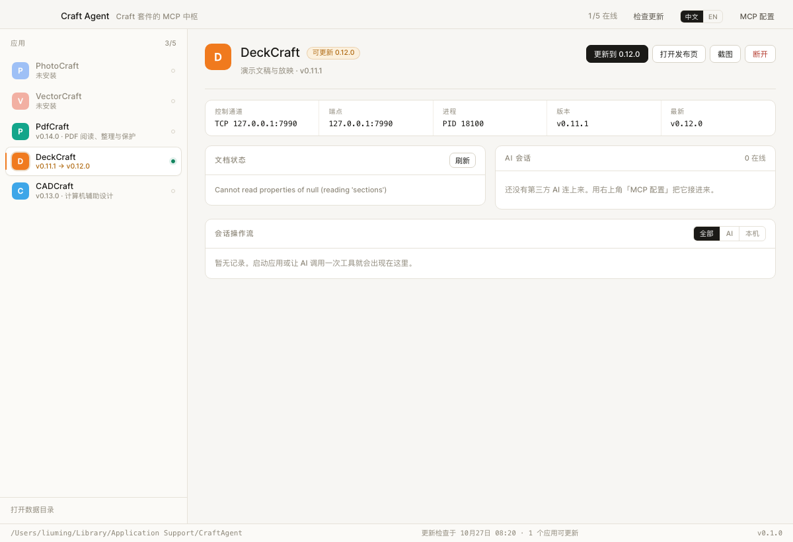

# Craft Agent

**Craft 套件的 MCP 中枢** —— 一个二进制，把 DeckCraft、WordCraft、GridCraft、PhotoCraft
等整个套件收进一个 MCP 服务器，同时让你看见 AI 正在对它们做什么。

<p align="center">
  
  
  
  
  
</p>

<p align="center">
  <a href="README.md">English</a> ·
  <a href="#它是什么">它是什么</a> ·
  <a href="#安装">安装</a> ·
  <a href="#从源码构建">构建</a> ·
  <a href="#mcp-工具">MCP 工具</a> ·
  <a href="docs/control-protocol.md">协议文档</a>
</p>

<p align="center">
  
</p>

## 它是什么

Craft 套件是桌面图形工具，每个应用都能在启动时打开一个本地控制端点（`--control`），
用逐行 JSON 协议驱动 —— 这个项目就建在这道缝上。

一个二进制，两种活法：

- **`craft-agent`** 打开窗口：哪些应用装了、哪些在跑、开在哪个端点、各自打开的是哪份文档，
  以及一条实时流水 —— 每条命令都记在里面，AI 发的和手点的能分开。
- **`craft-agent mcp`** 是挂在 stdio 上的 MCP 服务器，给 Cursor、Claude Desktop 用，
  操作的是同一批应用进程。

界面刻意不做编辑器，也不内置聊天：AI 从 MCP 进来，人从应用自己的窗口进来，
两边操作的是同一个进程、同一份文件，谁做了什么都会落在同一条流水上。

## 为什么不是又一个 launcher

[ArtCraft Launcher](https://github.com/storytold/craft-launcher) 解决的是「装和开」。
这个项目解决的是「**让 agent 能动手，并且人看得见**」：

| | Launcher | Craft Agent |
|---|---|---|
| 首次安装 | ✅ | ✅ 与升级同一条路：校验 → 验签 → 放到位 |
| 升级 | ✅ | ✅ 下载 → 校验 → 验签 → 换包 → 留备份 |
| 卸载 | ✅ | ❌ 自己拖进废纸篓 |
| 应用运行状态 | 列表 | 列表 + 控制通道 + 端点 + 进程 + 文档 |
| agent 接入 | ❌ | ✅ 一个 MCP server 覆盖全部应用 |
| 操作留痕 | ❌ | ✅ 跨进程流水，区分「AI 做的」和「本机做的」 |

## 协议速览

完整实测记录见 [`docs/control-protocol.md`](docs/control-protocol.md)（英文）。

```
→ {"id":1,"method":"engine.execute","params":{"command":"slide.new","params":{"layout":"titleOnly"}}}
← {"id":1,"ok":true,"result":{"id":257,"index":0}}
```

四个事实决定了整个架构：

1. **JSON Lines，一行一请求一回复。** 网上流传的 `action={"key":"value"}` 格式是错的，
   服务端会回 `not a control request (missing string 'method')`。
2. **通道形态按应用不同。** DeckCraft 0.11.1 要 TCP 端口，PdfCraft 要 Unix socket 路径。
   Transport 是**每个应用自己的属性**，不是全局常量。
3. **命令表可以动态拉取。** `engine.commands` 在 DeckCraft 0.11.1 上返回 377 条，
   每条带标签、菜单路径和参数说明。MCP 工具据此生成，**不为某个应用硬编码命令名**。
4. **文档层存在但没有被发布。** `file.new` 会返回文档序号，但协议里没有文档 id、
   没有文档列表、没有任何命令接受文档参数 —— 想切换只有 `window.next {index}`，
   它就是改了名字的 `document.activate`。

## 架构

```
┌───────────────────────────┐        ┌──────────────────────────────┐
│ Cursor / Claude Desktop   │        │ 用户（看得见窗口）            │
└─────────────┬─────────────┘        └──────────────┬───────────────┘
              │ MCP (stdio, JSON-RPC)                │ 点击
              ▼                                      ▼
┌──────────────────────────────┐        ┌──────────────────────────────┐
│ craft-agent mcp              │        │ craft-agent（GUI）            │
│  · 工具层 craft_*            │        │  · 应用列表 / 状态 / 流水      │
│  · 命令表动态发现            │        │  · 启动 · 连接 · 断开          │
└─────────────┬────────────────┘        └──────────────┬───────────────┘
              │  控制通道（JSON Lines / TCP · Unix socket）
              └───────────────────┬────────────────────┘
                                  ▼
                    ┌──────────────────────────────┐
                    │ DeckCraft / WordCraft / …     │
                    │ --control <endpoint>          │
                    └──────────────────────────────┘

        ┌─────────────────────────────────────────────┐
        │ registry.json   哪个应用开在哪个端点（跨进程） │
        │ sessions.jsonl  操作流水（跨进程，只追加）     │
        └─────────────────────────────────────────────┘
```

两个进程不共享内存，所以靠数据目录里的两份文件对齐：

- **`registry.json`** —— GUI 启动应用后写入端点与 PID；MCP 进程读它来**接管同一个实例**，
  读不到就退回去探测默认端点。
- **`sessions.jsonl`** —— 谁连上来、调了什么命令、成功与否、耗时多少。GUI 每 2 秒推给界面。

## 目录

```
main.go                    多模式入口：GUI / mcp / apps / versions / update / run
internal/
  craft/catalog.go         套件清单：安装路径、启动参数、通道形态
  control/client.go        控制通道客户端（TCP / Unix，请求-响应配对、重连）
  control/api.go           语义化方法：Commands / Execute / Document / Screenshot
  host/host.go             进程宿主：发现、启动、端点分配、注册表
  journal/journal.go       跨进程操作流水（JSONL，满了自动轮转）
  mcp/server.go            MCP 服务器：元工具 + 命令表发现
  mcp/compose.go           deckcraft_text / deckcraft_style / deckcraft_page / craft_batch
  mcp/doc.go               craft_doc：文档锚点与写入前守卫
  release/feed.go          查最新版本：官方聚合 feed 优先，GitHub 回落，6 小时缓存
  release/installed.go     读本机版本：Info.plist / 文件版本 / --version
  update/update.go         挑资产、下载、校验和
  update/install_darwin.go macOS：挂载 dmg → 验签 → 暂存 → 换包 → 留备份
services/app.go            Wails 绑定（状态、动作、流水、更新、MCP 配置）
frontend/                  Vite + TypeScript，无框架；i18n 在 src/i18n.ts
docs/control-protocol.md   控制通道的实测记录
```

## 安装

Craft Agent 自己还没有预编译包：版本 0.1.0，接口每天都在动。请从源码构建（下一节），
把二进制放到 `PATH` 里的任意位置即可。

**应用是另一回事 —— Craft Agent 会装。** 一台新机器上放一个二进制就够：在窗口里选中应用
点「安装」，或者在命令行里：

```bash
craft-agent install deckcraft        # 没装就装，装了就是升级
```

它和升级是同一条代码路径，因为在磁盘上做的是同一件事：下载、核对校验和、挂载镜像、
验签、把应用包放到该在的位置。区别只有两点：落到哪（`/Applications`，写不进去时退到
`~/Applications`），以及要不要把旧副本留成备份。

卸载仍然归你：把应用拖进废纸篓。下次打开界面，它就会显示成未安装。

## 从源码构建

需要 Go 1.25+、Node 18+、`wails3`（v3.0.0-beta.29）。

```bash
git clone https://github.com/extrame/craft-agent.git
cd craft-agent

# 1. 生成前端绑定（改了 services 的方法签名后要重跑）
wails3 generate bindings -ts -i

# 2. 前端产物（会被 embed 进二进制）
cd frontend && npm install && npm run build && cd ..

# 3. 构建
go build -o bin/craft-agent .
# 或者打完整的应用包：
wails3 build
```

> 二进制 embed 了 `frontend/dist`。为了 fresh clone 也能直接 `go build`，仓库里放了一张
> 占位页；跑完第 2 步才会变成真正的界面。

开发模式：`wails3 dev`（前端热更新，Go 改动自动重启）。

只想看界面、不想连后端时：

```bash
python3 tools/preview_mock.py 8799   # 用造出来的数据喂 Wails 绑定，再开 http://127.0.0.1:8799
```

它把 `frontend/dist` 当静态站点，并应答 `/wails/runtime` 的绑定调用，用来核对布局与
中英文案；不进构建，也不进二进制。

## 运行

```bash
craft-agent                        # 打开状态面板
craft-agent apps                   # 列出套件与本机状态（排查「为什么连不上」先跑这个）
craft-agent versions               # 本机版本 vs 远端最新
craft-agent install deckcraft      # 安装，或已装则升级（--dry-run 只挑安装包，不下载）
craft-agent update deckcraft       # 只做升级；没装的应用会被拒绝并提示用 install
craft-agent run deckcraft slide.inspect
craft-agent run deckcraft file.new '{"blank":true}'
craft-agent mcp                    # MCP stdio 模式
craft-agent mcp --apps deckcraft,wordcraft --tools minimal
```

数据目录 —— macOS `~/Library/Application Support/CraftAgent/`、Windows `%APPDATA%\CraftAgent\`、
Linux `~/.local/share/craft-agent/`：

```
registry.json     在跑的应用的端点与 PID
sessions.jsonl    操作流水
shots/            craft_screenshot 截下来的窗口图
run/              用 Unix socket 的应用的套接字
releases.json     最新版本缓存
cache/updates/    下载的安装包与解出来的新副本
```

界面语言跟随系统，右上角可切中文 / English；选择记在 `localStorage`，
词条在 `frontend/src/i18n.ts`（零依赖，`data-i18n` 标注 + `t(key, vars)` 插值）。

## MCP 工具

窗口里的「MCP 配置」给出可直接粘贴的片段，等价于：

```json
{
  "mcpServers": {
    "craft-agent": {
      "command": "/path/to/craft-agent",
      "args": ["mcp"]
    }
  }
}
```

暴露 12 个工具。控制通道的上下文有三层，每一层都需要不同的处理方式：

```
document（隐式，无参数，只能靠 window.next 切）
  └ slide（隐式，insert.* 没有页参数，靠 slide.go 摆正）
      └ shape（显式，命令都带 ids，可靠）
```

**文档层（先看这一层）** —— 它是最外层、也是最容易被忽略的一层：

| 工具 | 作用 |
|---|---|
| `craft_doc` | `info` 读活动文档身份 / `list` 枚举全部打开的文档 / `use` 切换到指定文档并锚定 / `new` 新建并锚定 / `close` 关闭 / `anchor` 就地重锚 / `release` 解除锚定 |

**封装层（推荐先用）** —— 一次调用完成一个意图，结果由应用自己回报：

| 工具 | 适用范围 | 作用 | 替代的裸命令序列 |
|---|---|---|---|
| `deckcraft_page` | DeckCraft | 建页 / 切页 / 删页 / 复制 / 移动，并保证结束后停在确定页 | `slide.new` + 自己记得 `slide.go` |
| `deckcraft_text` | DeckCraft | 新建或改写文本框并排版（字体/字号/加粗/颜色/对齐/锚点/项目符号），返回生效值与落页校验 | `insert.textBox → edit.select → text.edit → text.selectAll → format.fontDialog → format.align → text.exit` |
| `deckcraft_style` | DeckCraft | 按 id 批量排版，可跨页，逐条回报成功/失败 | 每个形状重复上面 6 条 |
| `craft_batch` | 任意应用 | 一次发多条命令，逐步返回结果，遇错即停；`slide` 可先钉页 | 每条命令一轮往返 |

`craft_doc` 和 `craft_batch` 是通用的 —— 它们对幻灯片模型不做任何假设。`deckcraft_` 前缀
是同一句承诺的另一半：那三个工具在别的应用上直接拒绝，而不是跑到一半才发现模型不存在。

**裸通道（兜底）**：

| 工具 | 作用 |
|---|---|
| `craft_apps` | 列出套件与状态（安装 / 在线 / 端点） |
| `craft_open` | 连接应用，没开就启动 |
| `craft_inspect` | 读当前文档结构与身份（页、对象 id、选区） |
| `craft_run` | 执行一条命令（参数按该命令自己的文档）；写入前过文档守卫 |
| `craft_commands` | 搜索该应用的命令表（id / 标签 / 参数说明） |
| `craft_screenshot` | 截一张窗口图落盘，返回路径 |
| `craft_close` | 断开（并结束本会话启动的进程） |

## 为什么自研这几个 deckcraft 命令

控制通道是完整的：应用能做的它都能做。但它不是模型需要的那种完整 ——
**它只有图元，没有意图。**

「把标题放到第 3 页，40pt、加粗、居中」这件事背后没有一条命令。有的是七条：
`insert.textBox`、`edit.select`、`text.edit`、`text.selectAll`、`format.fontDialog`、
`format.align`、`text.exit`。每一条只有在「上一条留下了正确的隐式状态」时才有意义：
正确形状里的文本选区、正确的页、正确的文档。而这些状态调用方一个都看不见，
也一个都不跨调用存活。

所以缺的不是更多命令，是**记账**。而记账恰恰是模型做不稳的事 —— 它唯一的反馈是工具返回值，
而这些失败全是静默的：

| 必须记住的状态 | 忘了会发生什么 |
|---|---|
| 当前是第几页 | insert 落到别的页；调用照样报成功 |
| 这个 id 在不在当前页 | `edit.select` 回 `{"selected":[]}`；不算错误 |
| 有没有文本选区 | `format.*` 回 `null` 或 `select text or a shape` |
| 当前是哪份文档 | 整次写入落进另一个文件；任何地方都不报错 |

静默失败没法靠「看工具输出」调试。只能由**能回读状态的东西**去避免 —— 而那个东西只能是代码。

每一行的依据都在 DeckCraft 0.11.1 上实测过：

1. **`format.*` 全家没有 `ids` 参数**，只作用于当前文本选区。选区又不跨调用存活，
   所以「给一个文本框设字体」在裸通道上是 6 条命令的固定舞蹈，中间任何一步失败都只是
   `null` 或一句 `select text or a shape`。
   → `deckcraft_text` / `deckcraft_style` 把这段收进去，并用 `format.state` 回读
   **应用自己报的生效值**。

2. **跨页 `edit.select` 不报错，只回 `{"selected":[]}`**。形状 id 只在它所在的页有效，
   但通道不会告诉你「这个 id 在别的页」。
   → 工具先 `slide.inspect` 定位形状所在页、切过去，再检查 `selected` 里到底有没有它；
   选不中就中止并说明原因，不继续发格式命令。

3. **`enabled` 是运行时上下文，不是「命令存不存在」**。没有文本选区时 `format.*`、
   `text.selectAll` 的 `enabled` 都是 `false`。早期版本按 `enabled` 过滤，结果是模型永远
   搜不到格式类命令、工具误判应用不支持而拒绝执行。
   → 存在性判断只看 id；`enabled` 只作为提示。

4. **文档层没有任何参数，只能靠 `window.next {index}` 切**。用户手动新建/切换文档后，
   agent 的下一条 `insert` 会安静地写进**另一份文档**，不报错、不提示。
   → 每个写工具第一次调用时锚定活动文档（`file.info` 的 title+path 作指纹），之后每次写入前
   比对；不一致就**拒绝发送命令**并说明怎么切回来。文档级命令（`file.new` / `window.next` /
   `file.close`）视为显式意图，执行后自动重锚。

5. **`insert.*` 没有页参数**，只跟当前页。`slide.new` 本身会切页，但
   `design.background {index}` 这类命令会顺手把活动页切回去，后面的 insert 就全落到别的页上。
   → `deckcraft_page` 建页后显式 `slide.go`；`deckcraft_text` 回报 `verified.onSlide`；
   `craft_batch` 支持 `slide` 先钉页。

一个对照：把「一页标题 + 两段正文 + 统一改一遍字号」这件事，裸通道要 20 条左右命令、
其中至少 4 次调用会因选区问题失败重试；用这几个工具是 1 次 `deckcraft_text` +
1 次 `deckcraft_style`，且失败会明确落在某个 id 上。

### 为什么前缀是 deckcraft_

因为它们假设的模型是 DeckCraft 的：幻灯片、文本框、作用于选区的 `format.*`。
WordCraft、GridCraft 可能根本没有 `text.selectAll`；PdfCraft 的「页」是文档页，不是幻灯片。
叫 `craft_text` 等于承诺一个没测过的可移植性；叫 `deckcraft_text` 把范围写进名字，
并且由工具强制执行 —— 换到别的应用上直接拒绝，指回 `craft_run`。

`craft_doc` 和 `craft_batch` 保留通用前缀，因为它们确实是通用的：一个搬运命令、
一个看住文档身份，都不假设命令的语义。

### 它们刻意不做什么

- **不做富文本分片**：一次调用一种格式。段落里单独加粗一个词，仍然要
  `text.find` + `text.select` + `format.*` 手工定位。
- **不做事务**：`craft_batch` 在第 7 步失败，前 6 步照样生效，目前没有可回滚的快照。
- **不做排版引擎**：你给什么属性就设什么属性，不会替你决定标题该是 40pt。

设计约定仍然成立：**一次命令是用户的一次撤销步**。`craft_batch` 省的是网络往返，
不是撤销粒度 —— Cmd+Z 撤销的仍然是一步。

## 更新

两件事拆在两个包里，因为时间尺度差得远：

- `internal/release` 回答「最新是多少」。每次启动都查，走官方聚合 feed（13 个应用一次拿齐），
  失败回落 GitHub，结果缓存 6 小时。GitHub 匿名限流 60 次/小时，套件十几个应用，
  一开机就能把额度烧光 —— 这是先查 feed 的唯一原因。
- `internal/update` 回答「怎么装上去」。只在用户点安装/更新（或跑 `craft-agent install`）时
  跑一次，会下载上百 MB、挂载磁盘镜像，把应用包放到位 —— 首次安装是创建，之后是替换。

顺序固定，任何一步失败都停在原地：

| 步骤 | 做法 | 失败时 |
|---|---|---|
| 挑资产 | 先按 `应用-版本-平台-架构.ext` 精确匹配，退化为按后缀挑，排除 `-cli-` / `-web-` / `SHA256SUMS` / `.zsync` | 报「没有适用于本平台的安装包」 |
| 下载 | 流式写 `.part`，边写边算 SHA-256 | 校验和不符就删掉下载 |
| 校验和来源 | GitHub 资产的 `digest`；没有就取同一发布的 `SHA256SUMS.txt`；两处都没有 → **拒绝安装** | 明确说缺校验和，不静默放行 |
| 地址白名单 | 必须是 `https://github.com/<该应用仓库>/releases/download/…`，重定向只许落 GitHub 域名 | 可疑条目直接丢弃，不进候选 |
| 挂载 | `hdiutil attach -nobrowse -readonly -noverify` 到本次专用的空目录 | 重试 4 轮（diskimages-helper 一次只接一个镜像） |
| 验签 | `codesign --verify --deep --strict`，再要求签名团队与**已安装副本**一致 | 不符就拒绝替换 |
| 验版本 | 读新副本 `Info.plist` 比对发布版本（只比前三位：bundle 常只写数字） | 不符就拒绝替换 |
| 换包 | `ditto` 到目标目录旁的暂存位 → 旧副本改名成 `<App>.app.old-<时间>` → 新副本 rename 到位 | rename 失败自动把旧副本挪回来 |

- **只在 macOS 上静默装完**。Windows / Linux 做到「下载 + 校验」就把安装包交给系统：
  msi 要提权、deb/rpm/AppImage 装法各异，没验证过的自动安装比让用户点两下更危险。
- 应用正在运行时先请它自己退出（AppleScript `quit`，给用户留保存的机会），退不掉就
  如实报错，不强杀。装完如果更新前是开着的，会重新拉起来。
- 界面上的进度来自后端事件 `craft:update`：下载给百分比与「已下/总量」，
  校验与换包给不确定态动画 —— 不知道长度的阶段不假装有百分比。
- 仓库改名跟随 feed 的 `repo_renames`（只在本账号内跟）：GitHub 会为重定向改名，
  但**重定向后的下载地址属于新仓库**，用旧仓库名校验会把所有资产判成非法。

## 已知边界

- **只有 DeckCraft 和 PdfCraft 的通道形态经过实测**。其余 11 个应用在 `catalog.go` 里
  标了 `--control` 但没有 `Transport`，宿主会尝试按 socket 探测，探测失败就如实报「未确认」，
  不会假装支持。
- CADCraft 本机 0.11 版本没有找到控制参数，`--help` 直接开窗口。
- 内置 agent 对话**故意没有做**：这个项目的定位是「给第三方 AI 提供能力 + 给人看清状态」。
- MCP 工具目前是 12 个（1 文档 + 4 封装 + 7 元工具）；`--tools core|full` 的命令级工具生成仍预留，
  一个应用几百条命令，全开会把模型上下文塞满。
- `deckcraft_*` 假定的是 DeckCraft 的模型（`insert.textBox` / `text.selectAll` /
  `format.fontDialog`）。用之前会核对该应用的命令表，缺哪条就明确拒绝并让你退回
  `craft_run`；换到别的应用上直接拒绝。
- 封装层不做「写前快照」：`craft_batch` 中途失败会停，但已执行的那些步仍然生效，
  需要回退得靠用户的撤销，或后续加 `document.inspect` 快照 + 重建。
- **文档身份只能靠 `title + path` 认**，因为通道不发布文档 id。后果是两个：
  另存为 / 重命名会让守卫误判成「换了文档」，这时用 `craft_doc anchor` 就地重锚；
  两份同名同路径的文档（同一文件开两次）无法区分。
- `craft_doc list` 是**真的逐个切窗口再切回**，界面上会看到一次闪动；
  它是唯一能拿到文档列表的办法，别在用户正在操作时高频调用。
- 文档锚点是**会话级单一目标**：同时要改两份文档时必须显式 `craft_doc use` 交替切换，
  没有「一次写入多个文档」的并行能力 —— 这受限于通道本身，不是封装层偷懒。
- 首次安装没有「已装副本」可比对签名团队，所以只做严格自检；
  「签名方必须与已装版本一致」这条只对升级成立。
- 备份 `<App>.app.old-<时间>` 不会被自动清理，装过几版就是几个目录，需要手动删。
- 没有批量更新：一次一个应用，失败只影响那一个。
- 不装预发布：feed 里 `prerelease` 为 true 的发布照常显示版本号，但界面不会提示升级到它。
- `app_renames`（应用改名）不跟随 —— 清单里的安装路径是 `<Name>.app`，跟了反而找不到已装的那份。

## 参与

Issue 和 PR 都欢迎，尤其欢迎**实测出来的协议事实**。唯一要紧的规矩：
**说行为，就带上你在哪个应用、哪个版本上测的。** `docs/control-protocol.md` 里每张表都
这么标；没有版本的结论只是猜测，会误导下一个读者。

提交前跑一遍：

```bash
go vet ./... && go test ./internal/...
cd frontend && npx tsc --noEmit && npx vite build --mode production
```

真实网络测试默认关闭，需要显式打开：`CRAFT_RELEASE_LIVE=1 go test ./internal/release/`、
`CRAFT_UPDATE_LIVE=1 go test ./internal/update/`（后者会真的下载安装包并装进临时目录）。

## 许可

MIT OR Apache-2.0 双协议，任选其一 —— 与 Craft 套件本身一致。见
[`LICENSE-MIT`](LICENSE-MIT)、[`LICENSE-APACHE`](LICENSE-APACHE) 与 [`NOTICE`](NOTICE)。

这是一个独立的非官方项目，与 Craft 套件团队无关；仓库不分发任何应用图标或品牌素材。
